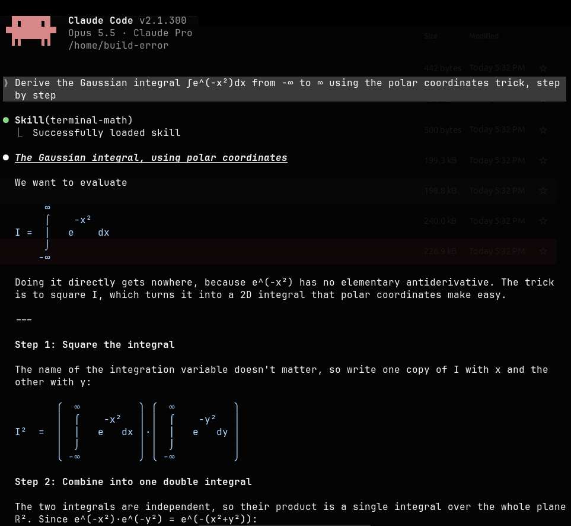
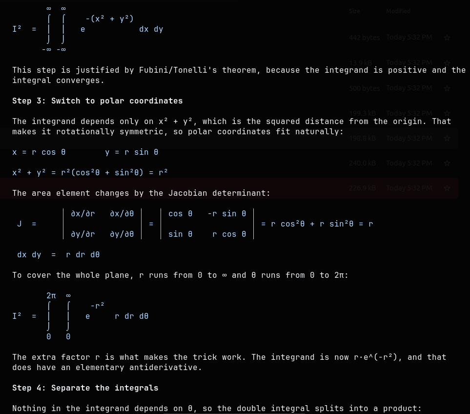
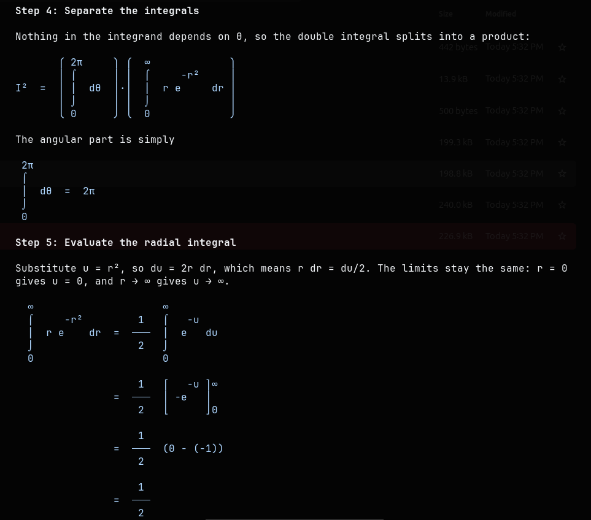
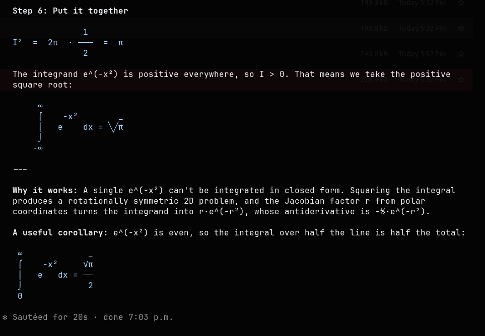

<div align="center">

# terminal-math

*Math your terminal can actually display. No more raw LaTeX in agent replies.*

[](LICENSE)
[](https://skills.sh)
[](#compatibility)

[Features](#features) • [Installation](#installation) • [Usage](#usage) • [Examples](#examples) • [How it works](#how-it-works)

</div>

---

Terminals don't render LaTeX, so math from an AI coding agent usually shows up as raw source like `$\frac{a}{b}$`. **terminal-math** is an agent skill that makes your agent draw math with Unicode characters instead, laid out over several lines and readable in any terminal.

<table>
<tr><th>Without the skill</th><th>With the skill</th></tr>
<tr>
<td>

```
$\int_{-\infty}^{\infty} e^{-x^2}\,dx = \sqrt{\pi}$
```

</td>
<td>

```
 ∞               _
 ⌠    -x²      ╲╱π
 ⎮   e    dx = ───
 ⌡              2
-∞
```

</td>
</tr>
</table>

## See it in action

A real Claude Code session using the skill, asked to *"derive the Gaussian integral using the polar coordinates trick, step by step"*:

<p align="center">
  
</p>

<details>
<summary>See the full derivation (polar coordinates, Jacobian, final result)</summary>
<br>
<p align="center">
  
  
  
</p>
</details>

## Features

- **Automatic:** kicks in whenever a reply contains math, with no command needed
- **Equations drawn over several lines:** fractions, roots, integrals, sums, limits, derivatives, matrices, determinants, piecewise functions
- **Short math stays in the sentence:** `x² + y² = r²`, `aᵢⱼ`, `∀ε > 0 ∃δ`, using real superscript and subscript characters
- **Step-by-step derivations:** one step per line with the `=` signs lined up
- **Correctness first:** if something can't be drawn clearly, it falls back to plain single-line Unicode rather than getting the math wrong
- **LaTeX when you ask for it:** request LaTeX and you get the source to copy as well as the drawing
- **Works across agents:** one install covers Claude Code, Codex, GitHub Copilot, Zed, and more

## Installation

Install it once for all your agents with the [skills CLI](https://skills.sh):

```bash
npx skills add build-error/terminal-math --skill terminal-math -g
```

Drop `-g` to install it only for the current project.

> [!NOTE]
> Restart any open agent sessions after installing so they pick up the new skill.

<details>
<summary>Manual install (Claude Code)</summary>

```bash
git clone https://github.com/build-error/terminal-math.git
mkdir -p ~/.claude/skills
cp -r terminal-math/skills/terminal-math ~/.claude/skills/
```

</details>

## Usage

You don't need to do anything. Ask about anything mathematical and the agent draws the equations:

```
> derive the variance of a Bernoulli random variable
> explain gradient descent with the update rule
> what's the determinant of a 2×2 matrix?
```

You can also turn it on explicitly with `/terminal-math` (Claude Code), or say *"render the math"*.

> [!TIP]
> Need something you can paste into a paper or Overleaf? Ask for *"the LaTeX too"*. You'll get a copyable `latex` block next to the drawing.

## Examples

**Quadratic formula**

```
            ________
     -b ± ╲╱b² - 4ac
x = ─────────────────
           2a
```

**Basel problem**

```
 ∞
 ⎲   1     π²
 ⎳  ─── = ───
n=1  n²    6
```

**Matrix and determinant**

```
    ⎡ a  b ⎤                 │ a  b │
A = ⎢      ⎥ ,     det A =   │      │ = ad - bc
    ⎣ c  d ⎦                 │ c  d │
```

**Piecewise function**

```
       ⎧  x    if x ≥ 0
|x| =  ⎨
       ⎩ -x    if x < 0
```

**Aligned derivation**

```
(a + b)² = (a + b)(a + b)
         = a² + ab + ba + b²
         = a² + 2ab + b²
```

## How it works

The skill is a single instruction file, [`skills/terminal-math/SKILL.md`](skills/terminal-math/SKILL.md), that agents load when math comes up. It contains:

1. **Rules:** when to keep math inline, when to draw it over several lines, how to line things up, and to never output raw LaTeX unless asked
2. **A symbol list:** Greek letters, operators, relations, set notation, superscripts and subscripts, and the box-drawing pieces used to build brackets, integrals, and sums
3. **Layout templates:** worked layouts for each kind of equation that the agent adapts

Nothing runs on your machine. There are no scripts, dependencies, or network calls. It only changes how the agent formats its replies.

## Compatibility

Works with any agent that supports the [open agent skills](https://skills.sh) format, including Claude Code, Codex, GitHub Copilot, Zed, and Amp.

> [!IMPORTANT]
> The drawings depend on monospace alignment and Unicode box-drawing characters. Most modern terminal fonts handle them well (JetBrains Mono, Fira Code, Cascadia Code, Iosevka, and the defaults in Ghostty, Kitty, WezTerm, and iTerm2). If brackets look broken, try a different font.
